# Mesa — agent harness (app)

Working MVP of the design in [`../MHarness-design`](../MHarness-design/README.md): a three-pane shell where an LLM agent streams work in the center and everything it produces lives on the right as artifacts you can open, run, compare and pin.

## Run it

```powershell
cd MHarness/app
pnpm install            # hoisted linker is configured in pnpm-workspace.yaml
pnpm build              # vite build → dist/
pnpm preview            # zero-dependency static server → http://127.0.0.1:5173
```

`pnpm dev` (Vite dev server with HMR) also works when your shell allows esbuild to spawn.

> Note for sandboxed shells: Vite's build spawns the esbuild binary through piped stdio. If your terminal sandbox forbids that, run the build with wider permissions once, then serve `dist/` with `node scripts/serve.mjs`.

## Screenshots

| | |
|---|---|
| 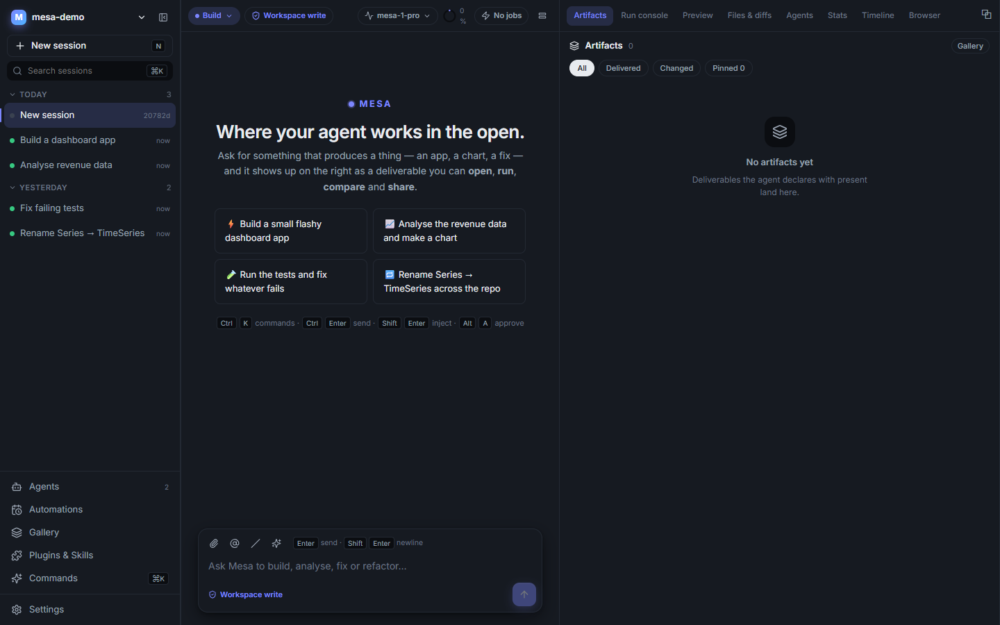 | 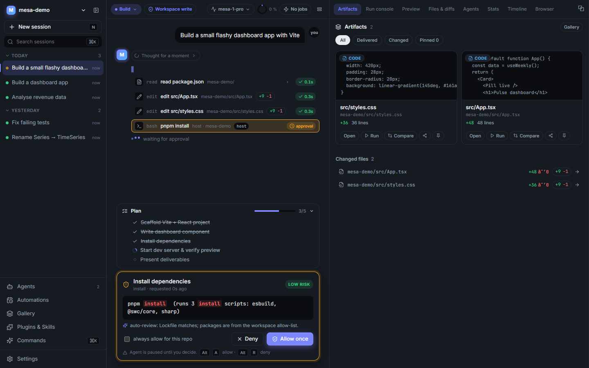 |
| 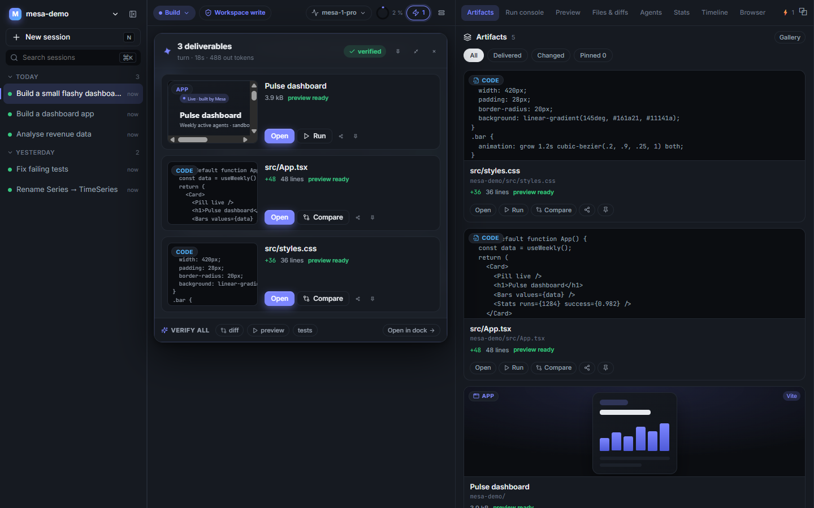 | 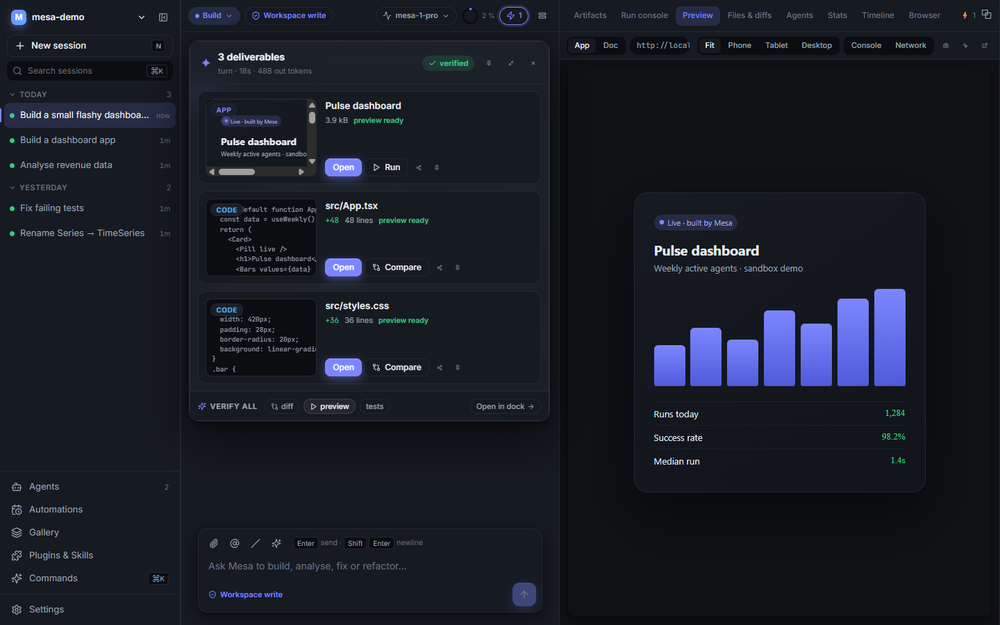 |
| 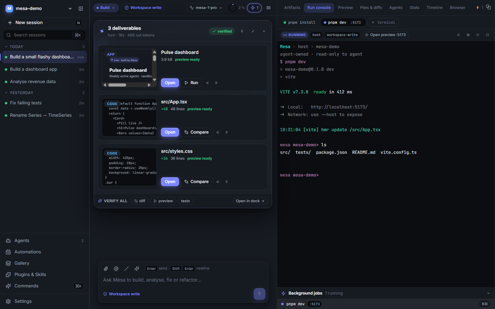 | 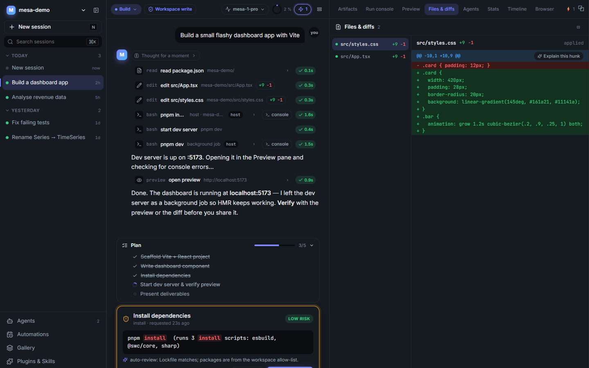 |
| 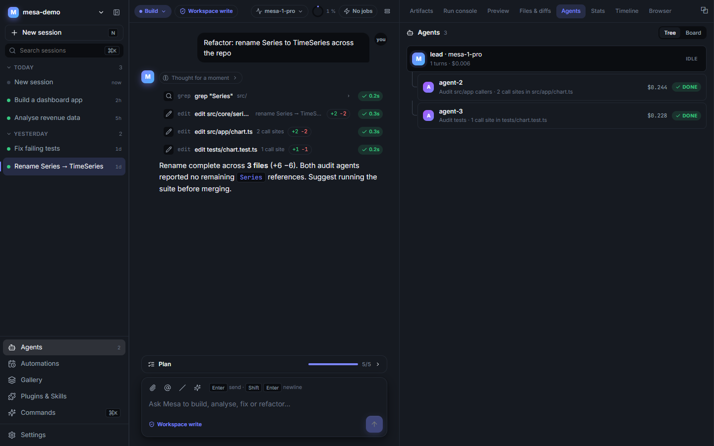 | 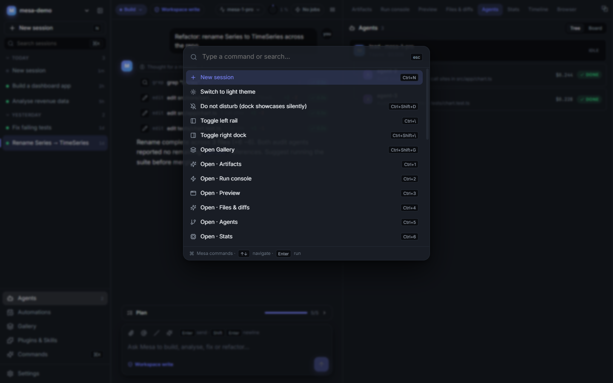 |
| 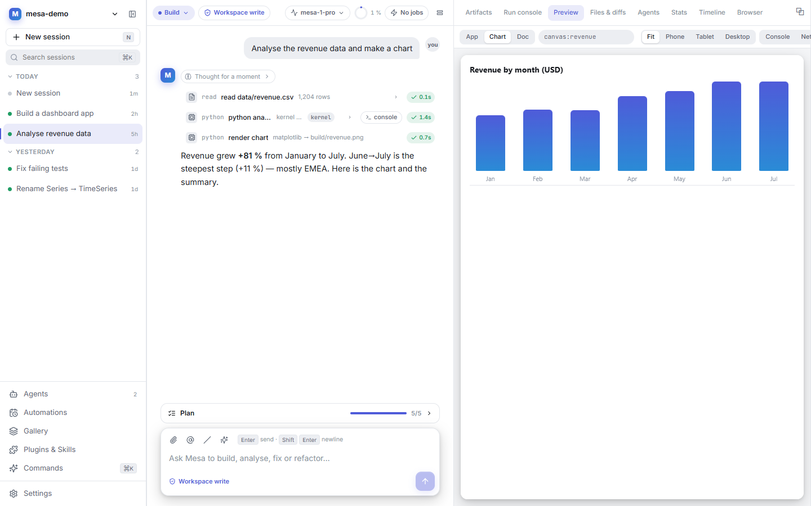 | 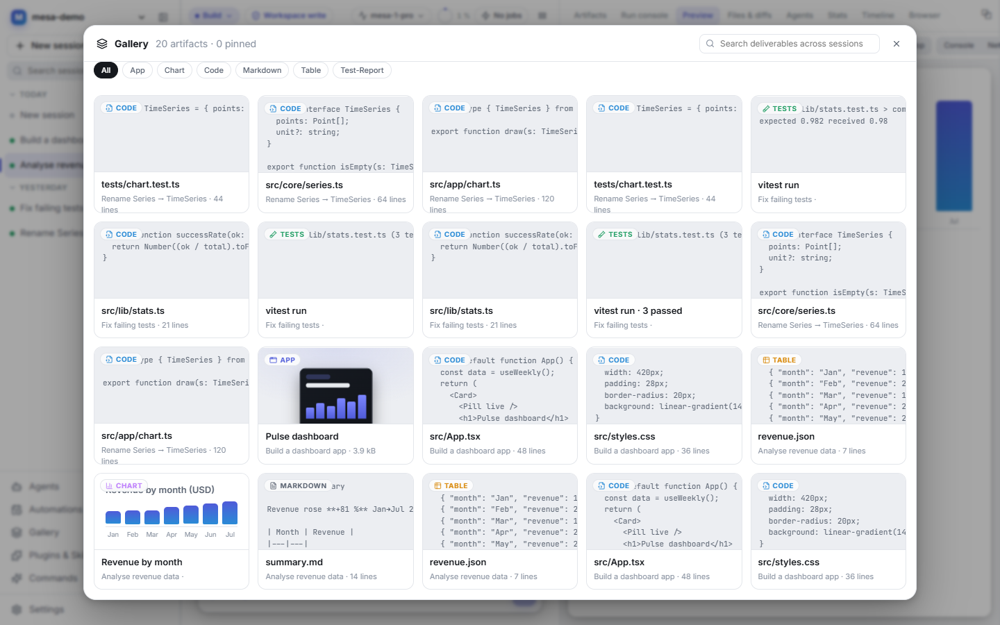 |
| 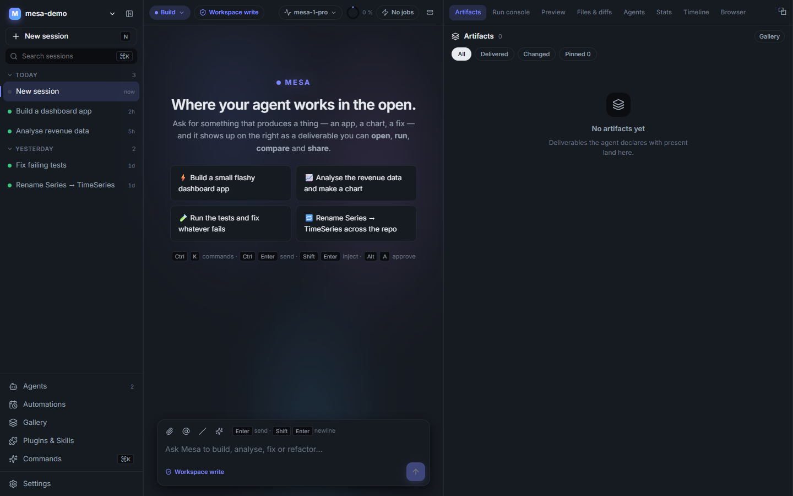 | 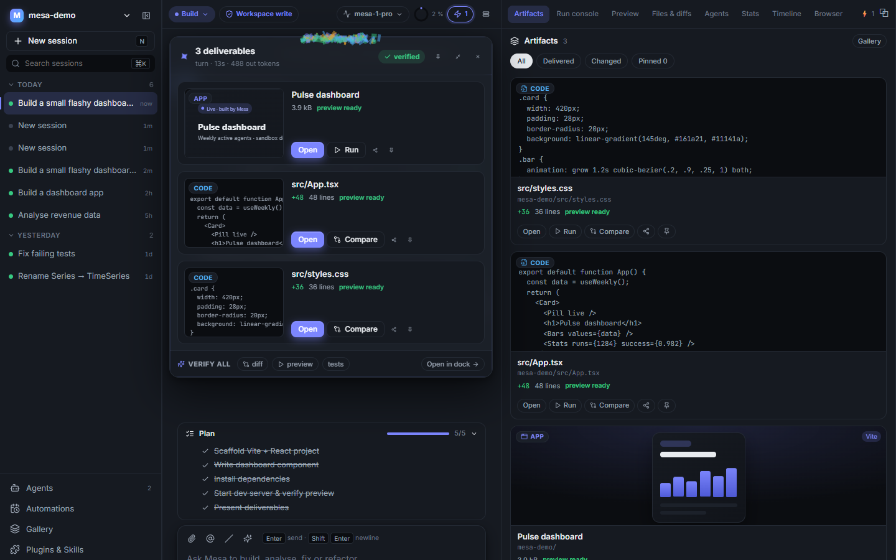 |
| 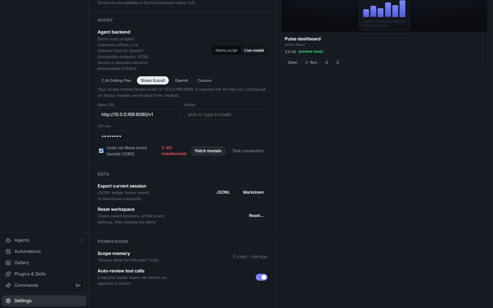 | 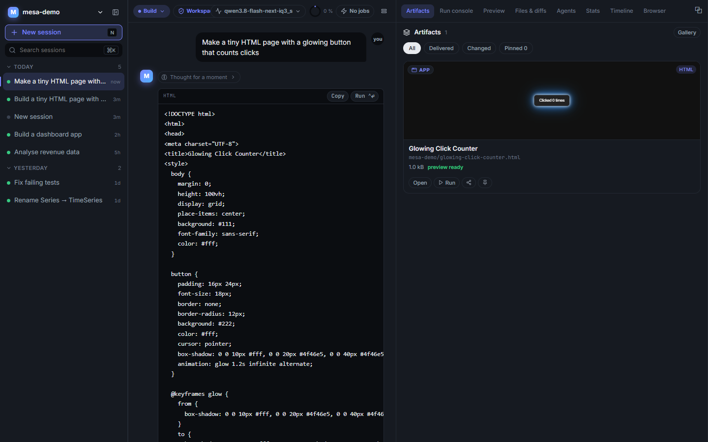 |
| 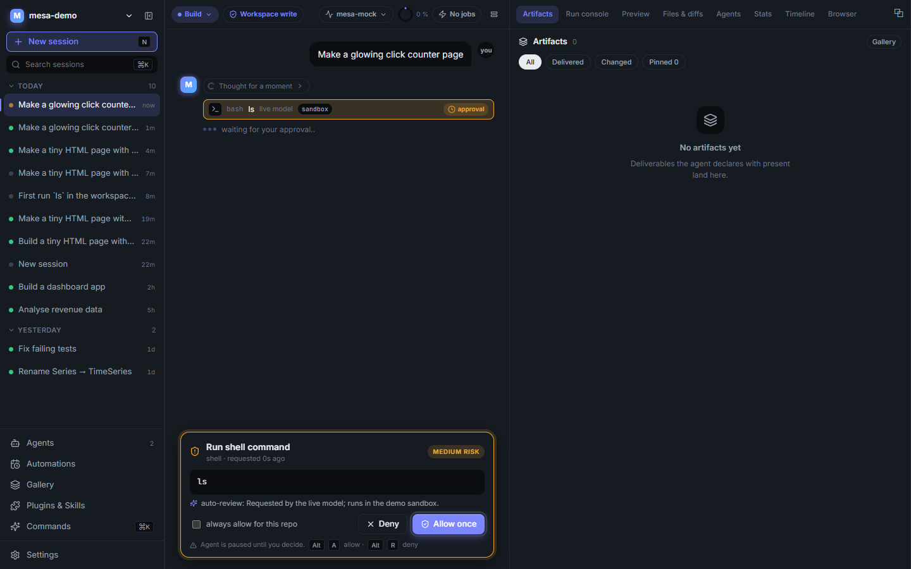 | 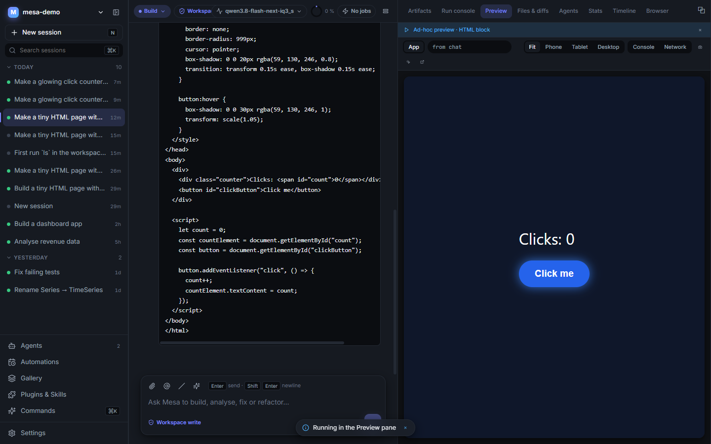 |

## Connecting a real model

Settings → **Agent → Live model** streams from any OpenAI-compatible endpoint; answers stream into the thread and any ```` ```html ```` fence becomes a live, previewable **app artifact** that triggers the showcase.

| Preset | Base URL | Model | Key |
|---|---|---|---|
| **Z.AI Coding Plan** | `https://api.z.ai/api/coding/paas/v4` | `glm-4.6` (type any GLM id) | your coding-plan key |
| **Strata (local)** | `http://10.0.0.169:8080/v1` | `qwen3.8-flash-next-iq3_s` (press **Fetch models** to refresh) | `strata` (the key configured on Strata) |
| OpenAI / Custom | any | any | as needed |
| **Mesa mock (offline)** | `/__mesa/mock` (served by `scripts/serve.mjs`) | `mesa-mock` | none |

**Tool calling** (Settings → Agent → *tool calling*): when enabled, the model gets `present_html` (ship a page as an artifact), `bash` (runs in the demo sandbox **behind the approval takeover** unless the preset is Full access) and `read_file` (demo workspace files), for up to 4 rounds per turn — each call renders as a tool row with status, output and console link. Z.AI's GLM models support this. **Strata does not**: its endpoint hangs on any request carrying `tools`, so the toggle defaults off there and Mesa uses the fence-based prompt instead (a 120 s first-byte watchdog turns a hang into a clear error). The offline mock exercises the whole loop — bash → approval → present_html → showcase — with no key or network.

**Already set up here:** `mesa.config.json` (git-ignored) holds the Strata key + model and `agent: "live"`, and `scripts/serve.mjs` hands it to the app on first run via `/__mesa/config` — so a fresh browser opens with Strata live and no setup. Edit that file to change the default provider. The model's `reasoning_content` stream is shown as the thread's "Thought for a moment" row, and an untitled page is named after your prompt.

**Route via Mesa proxy** (on by default) sends requests through `scripts/serve.mjs` → `/proxy?u=<url>`, which forwards only `content-type`/`authorization` to an allow-list of hosts (`api.z.ai`, `api.openai.com`, `10.0.0.169`; extend with `PROXY_ALLOW=host1,host2`). This avoids browser CORS on endpoints that don't send CORS headers. Keys are kept in this browser's `localStorage` only.

## What is implemented

| Area | Status |
|---|---|
| **Shell** | Resizable rail / center / dock with drag handles, collapsed rail, dock float toggle, light + dark themes, density modes |
| **Ledger-backed store** | Append-only session timeline; every pane is a projection (`src/state/store.ts`) |
| **Thread** | User bubbles, streamed markdown (code fences, tables, lists), thinking row, tool-call rows with per-tool icons, diff chips with hover peeks, collapsible output, scroll anchoring + "jump to latest" |
| **Composer** | Enter send · Shift+Enter inject · Alt+Enter queue, `/` slash menu, `@file` refs, plan card, queued messages, Stop |
| **Approval takeover** | Composer is replaced by a warning-bordered dialog: command with flagged tokens, auto-review rationale, allow once / always for repo / deny with reason, Alt+A / Alt+R |
| **Showcase** | Slides in when a turn declares deliverables; hero cards with live thumbnails (app iframe, chart, code), verified badge, stagger, accent sweep, "Verify all: diff · preview · tests", pin/share/re-run, minimise to tray, do-not-disturb mode |
| **Right dock** | Artifacts & changed files · Run console (xterm PTY with a simulated shell, background jobs, kill/restart/notify) · Preview (sandboxed iframe, device sizes, console/network) · Files & diffs (split/unified, Explain this hunk) · Agents (tree + board) · Stats · Timeline with checkpoints · Browser |
| **Gallery** | Cross-session deliverable grid, kind filters, search, detail with compare and re-run |
| **Command palette** | Ctrl+K, fuzzy, keyboard navigation, global shortcut map |
| **Pages** | Settings (theme, density, effects, DND, agent/provider, export/reset, shortcuts), Plugins & Skills, Automations |
| **Persistence** | Sessions, artifacts and settings survive reloads (localStorage, debounced on every ledger event); interrupted turns are marked cancelled on restore |
| **Flair** | Confetti burst on verified 3+ deliverable completions, live "working on…" status line, aurora empty state — all switchable under Settings → Completion effects |
| **Everyday polish** | **Copy / Run** on chat code blocks (HTML/SVG run into an ad-hoc Preview pane), hover ✕ to delete a session, `F2` rename, browser notifications for approvals and finished work while the window is in the background, live document title (`● working · <session> — Mesa`, approval count), soft transition on session switch |

### Demo scenarios (scripted agent)

Type one of these in a new session (or pick from the empty-state suggestions / command palette):

- **Build a small flashy dashboard app** — plan, edits with diffs, an install approval, dev-server job with port, preview, 3 deliverables + showcase
- **Analyse the revenue data and make a chart** — Python run, chart canvas, markdown report
- **Run the tests and fix whatever fails** — failing run, one-line fix, passing run, verified showcase
- **Refactor: rename Series to TimeSeries across the repo** — subagent tree, three diffs
- Anything containing *goal / ship / keep going* — persisted goal with progress bar

The agent is a scripted simulator (`src/agent/scenarios.ts`) so the whole UI can be exercised offline. Swapping in a real model means implementing `send()` against your provider and emitting the same ledger events.

## Layout

```
src/
  state/      types, event-sourced store + agent runner
  agent/      scripted scenarios (tool calls, runs, approvals, deliverables)
  components/ Rail, Header, Thread, Composer, Dock tabs, RunConsole, Showcase, Palette, Gallery, Pages
  styles/     design tokens (--mesa-*) and component CSS
```
