# Mesa

**A visual harness for LLM agents — the agent reads, writes, runs and *shows*; you steer, approve, inspect and launch.**

[](https://github.com/woolcoxm/mesa/actions/workflows/ci.yml) [](LICENSE) 

Mesa is a single window where a person and an LLM agent co-work. The conversation streams in the center; everything the agent produces lands on the right as an **artifact** you can open, run, compare and pin. When a turn finishes with deliverables, a **Completion Showcase** slides in with a hero card per artifact and one-click **Verify** (diff · preview · tests) — because the agent may be wrong, verification is never more than a click away.

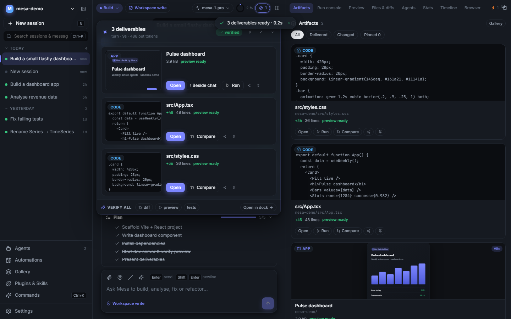

| | |
|---|---|
| Stack | React 19 · TypeScript · Vite · xterm.js — zero UI framework, design tokens in CSS variables |
| Models | Any OpenAI-compatible endpoint: **Z.AI Coding Plan**, **Strata**, OpenAI, custom, or the built-in **offline mock** |
| Modes | Scripted demo agent (no network) · live streaming with tool calling |
| Persistence | Event-sourced session ledger saved to the browser **and** mirrored to a workspace state file by the Mesa server — sessions survive reloads, new tabs and other browsers |
| License | MIT |

---

## Why

Today's agent harnesses make you *read* what happened. Mesa makes you **see** it: a generated dashboard is a live thumbnail in the showcase, a refactor is a diff you can flip to split view, a test run is a pass/fail artifact, and a dev server is a terminal you can type into. Every claim the agent makes can be turned into a rendered artifact or a test result in one click.

Design principles: **show, don't tell** · **verify is one click away** · **every flourish has a job and an off-switch** · **one ledger** (every pane is a projection of the same events) · **platform, not monolith**.

---

## Feature tour

| | |
|---|---|
| 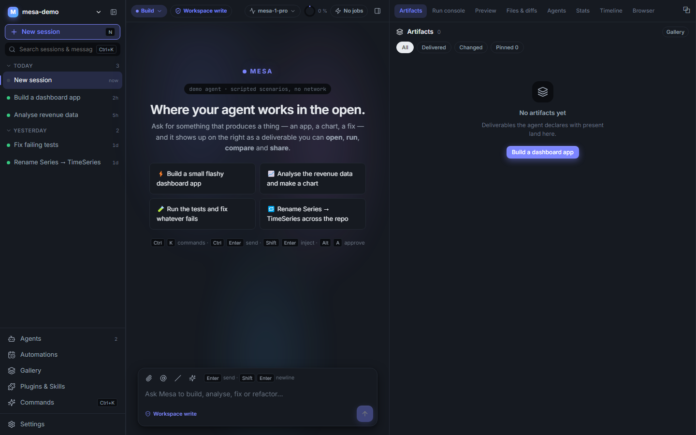 | 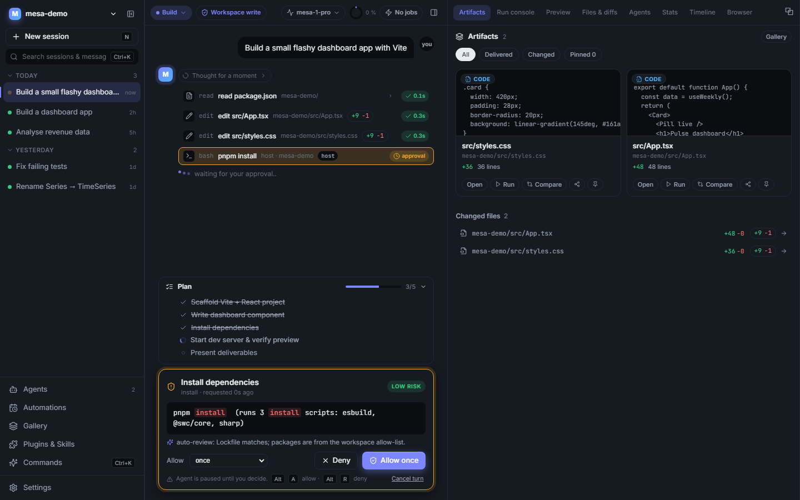 |
| **Three-pane shell** — session tree with state dots, streaming thread with tool rows and per-turn **Retry / Edit**, right dock with 8 tabs, command palette (`Ctrl+K`), light/dark/system themes. | **Approval takeover** — the composer becomes a decision: the exact command with flagged tokens, auto-review rationale, *allow once / always for this repo / deny with reason*. `Esc` denies, `Alt+A` allows. |
| 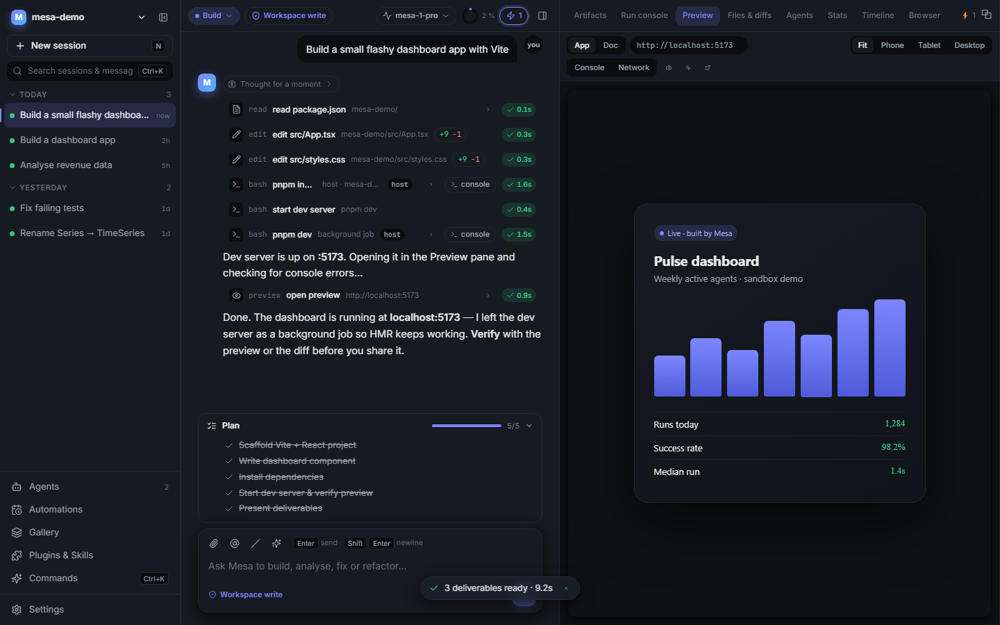 | 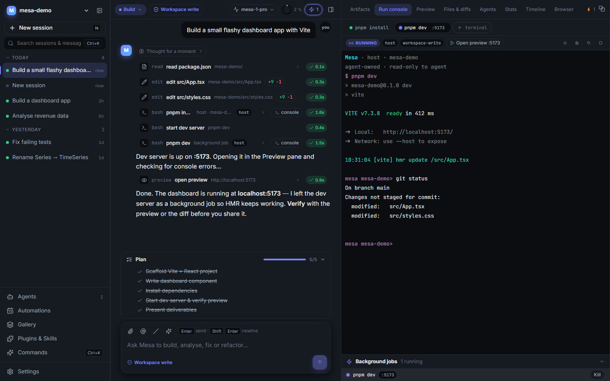 |
| **Live preview** — sandboxed iframe (no `allow-same-origin`), device sizes, console/network capture, screenshot-to-chat, element-to-agent. HTML code blocks in chat have a **Run** button. | **Run console** — real xterm PTY tabs per session, background jobs with kill/restart/notify, a simulated shell you can type into (`ls`, `git status`, `pnpm test`…). |
|  |  |
| **Files & diffs** — unified or split view, animated hunk reveals, "Explain this hunk" sends the hunk to the agent, hover peeks on every diff chip. | **Agents** — subagent tree with status and cost, or a kanban board of the plan. |
| 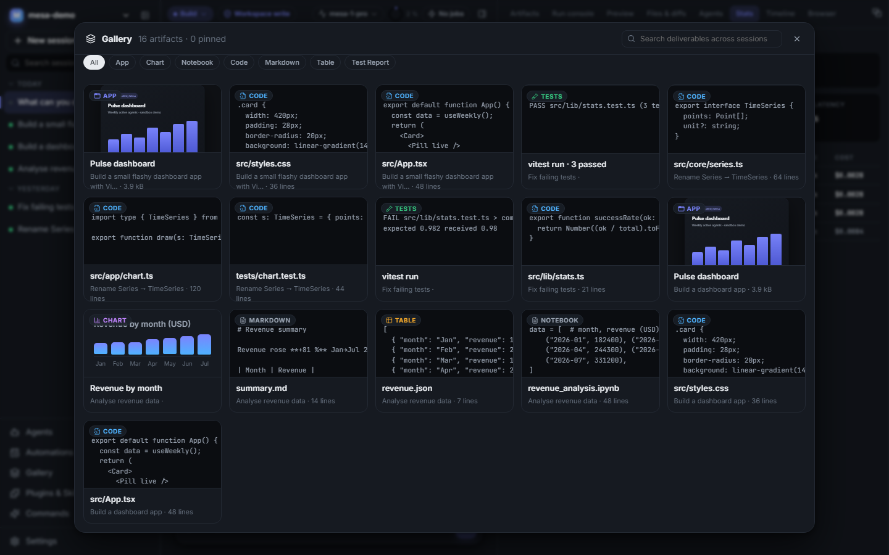 |  |
| **Gallery** — every deliverable across sessions: filters, search, detail view, side-by-side compare, re-run with fresh inputs, share links. | **Command palette** — fuzzy, keyboard-first; every tab, mode, demo and session is one keystroke away. |
|  | 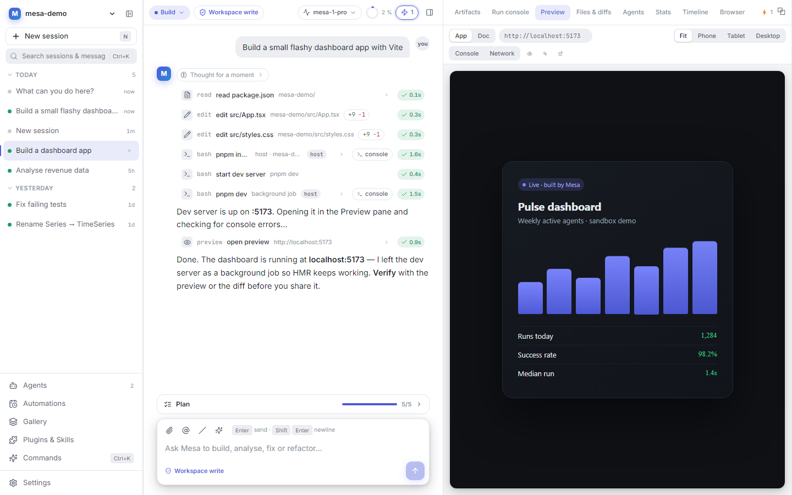 |
| **Settings** — provider presets (Z.AI, Strata, OpenAI, custom, mock), "Fetch models", "Test connection", export JSONL/Markdown, reset. | **Light theme** — the same tokens; dark and light both meet WCAG AA contrast. |
| 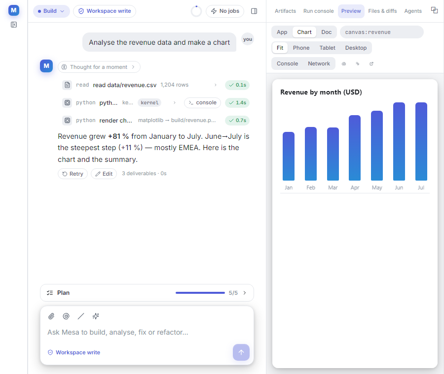 | 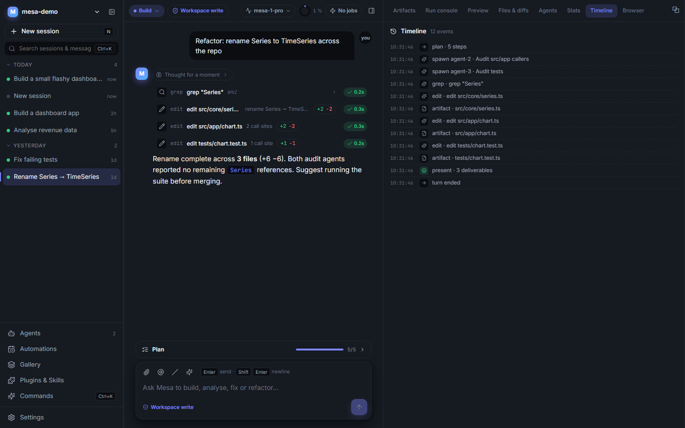 |
| **Narrow layout** — the rail collapses to icons under 960 px and the dock is capped, so the thread stays usable on a laptop. | **Timeline** — every event with timing bars; click an event to flash its tool row in the thread; checkpoints are restorable. |
| 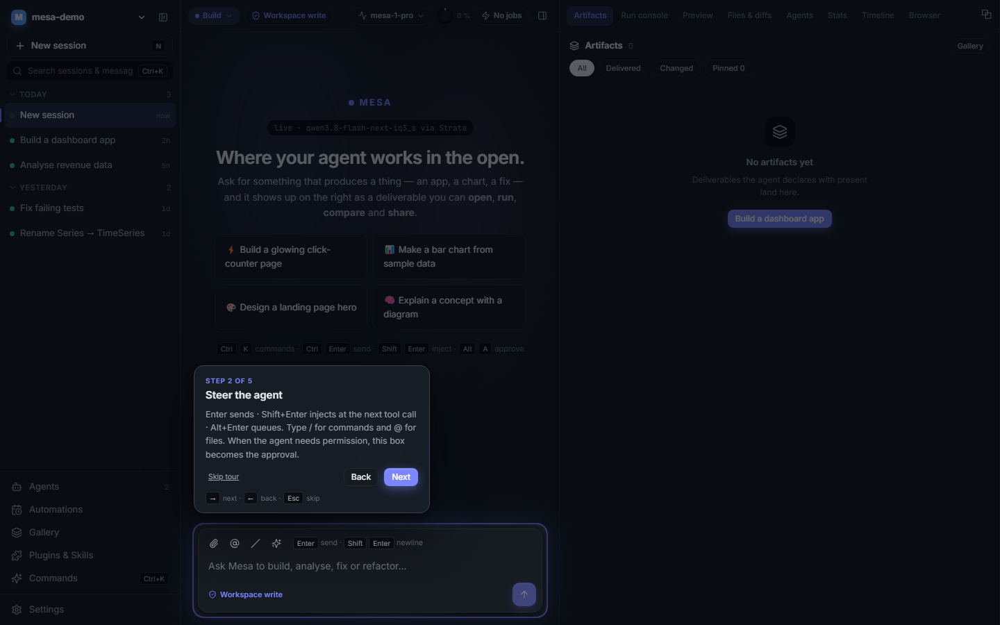 | 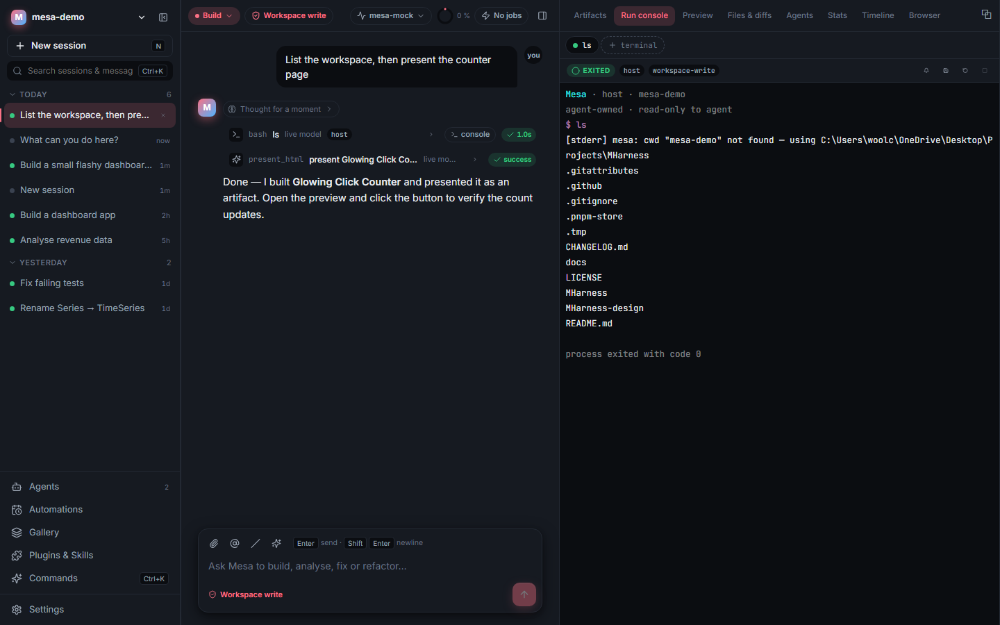 |
| **Guided tour** — an animated spotlight walks through the shell on first run; replay from Settings or the palette. | **Accent colours** — six palettes re-tint buttons, cursors, charts and the showcase in both themes. |
| 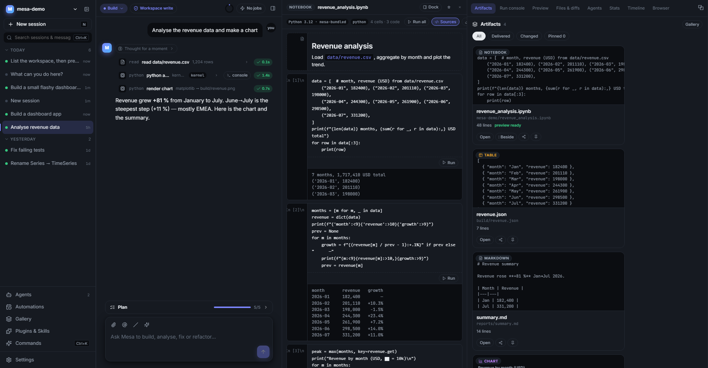 | 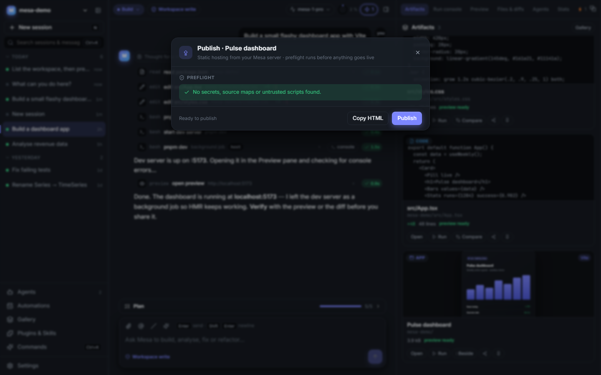 |
| **Canvas beside chat** — "Beside chat" on any app, chart or notebook deliverable opens it live in a resizable pane next to the thread (the rail auto-collapses to make room); drag the edge, `Esc` to close, "Dock" to move it back. | **Publish with preflight** — Share on an HTML deliverable scans it first (private keys, `sk-…`/AWS/GitHub/Stripe tokens, hard-coded secrets, source maps, untrusted external scripts, localhost links), refuses anything with a blocking finding, and otherwise serves it from your Mesa server at a copyable link you can open or remove. |
|  | 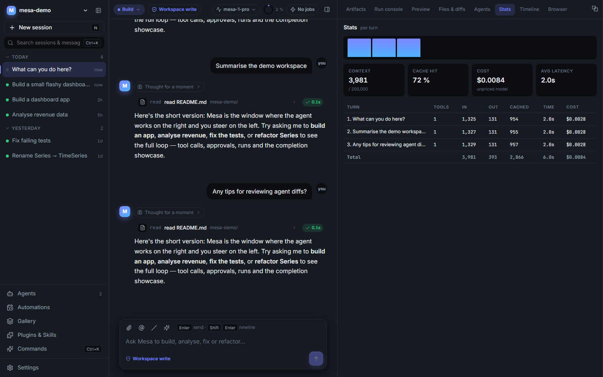 |
| **Notebooks that actually run** — `.ipynb` deliverables render as cells with `In [n]` counts, markdown, code and outputs (HTML in a sandboxed frame). Press **Run** on a cell or **Run all**: the cells execute in one real Python process on the Mesa host (state carries between cells, per-cell tracebacks, timeouts), the Run console records the run, and the cells fill with live output. "Convert to script" downloads the code cells. | **Stats** — context, cache hit, cost (estimated from list pricing when the model is known) and a per-turn token sparkline with hover tooltips; the timeline tab shows every event's timing. |

Small things that add up: deleting a session offers **Undo** for 7 seconds; **drop files** on the composer to attach them (HTML/SVG files open straight in the preview); the URL carries your place (`#/s/<session>/<tab>`) so a reload or a bookmark brings you back; the palette has **Accent · …** and **Density · …** commands; **@name in a prompt attaches that artifact's contents** (chips under the message show what was sent); hover any finished turn for **Retry / Edit / Copy**, hover any tool row to peek what it printed; dialogs trap keyboard focus and hand it back when they close; while a turn streams, the context meter shows a live **tok/s** readout.

> Every screenshot above is regenerated from a deterministic demo run with `pnpm shots` (headless Chromium), so the pictures always match the current build.

---

## Quick start

Runs on **Windows, macOS and Linux** (Node ≥ 18; nothing else to install — the dev server, model proxy and offline mock have zero dependencies).

```bash
git clone https://github.com/woolcoxm/mesa.git
cd mesa/MHarness/app
pnpm install          # macOS/Linux: `pnpm install` too; or `npm install` / `corepack enable`
pnpm build            # vite build → dist/
pnpm serve            # → http://127.0.0.1:5173  (same as `node scripts/serve.mjs`)
```

Open **http://127.0.0.1:5173**. A 60-second guided tour spotlights the rail, composer, header and dock on first run (replay it from Settings or `Ctrl+K`). It boots with five scripted demo sessions — click **Build a small flashy dashboard app** in the empty state to see the full loop: plan → edits with diffs → an install approval → dev-server job → preview → three deliverables and the showcase.

> `pnpm dev` (Vite dev server + HMR) works too, but `pnpm serve` is the full experience: it also hosts the model proxy, the bootstrap config and the offline mock model. Keyboard shortcuts use **⌘/⌥** on macOS and **Ctrl/Alt** elsewhere, and are matched by physical key so they work on every keyboard layout.

### First-run configuration

Mesa looks for `MHarness/app/mesa.config.json` (git-ignored) and applies it on launch:

```json
{
  "provider": { "preset": "strata", "baseUrl": "http://10.0.0.169:8080/v1", "apiKey": "…", "model": "…", "proxy": true },
  "agent": "live",
  "shell": true
}
```

Without it, the app starts in **Demo** mode, which needs no network or keys.

### Notebook execution (optional)

Add `"notebook": { "command": "python" }` to `mesa.config.json` and the **Run** buttons on notebook cells come alive: the server writes the cells to a temp file inside the repository, runs them in one interpreter process (shared state, per-cell markers splitting the output, a failing cell stops the run with its own traceback, 30 s timeout and 64 KB output caps), and the cells fill with the real output. Running a single cell replays the cells before it so its state is present, exactly like re-running from the top in Jupyter. Without the setting the Run buttons explain what to add.

### Real shell (optional)

With `"shell": true` (or `MESA_SHELL=1`), a live agent's `bash` tool runs **for real on the machine hosting `serve.mjs`** — `cmd.exe` on Windows (with a small `ls`/`cat`/`pwd` alias table so POSIX-style commands behave), otherwise your `$SHELL` with `-c`. Commands are confined to the repository folder, killed after a timeout, and **always gated by the approval takeover** in the UI. With the shell off, live `bash` calls run in a simulated sandbox instead.

### External agents over ACP (experimental)

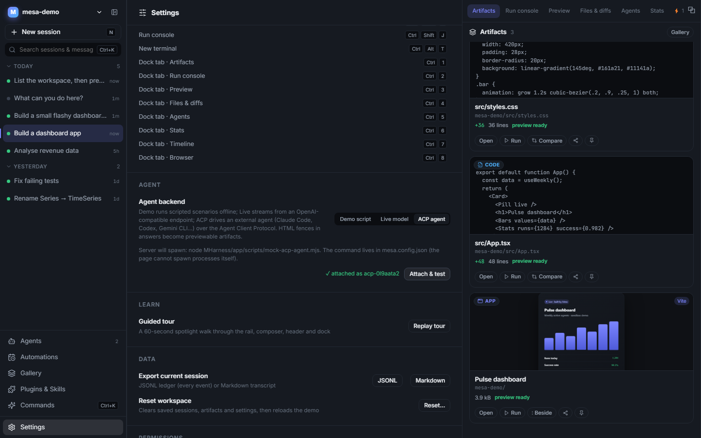 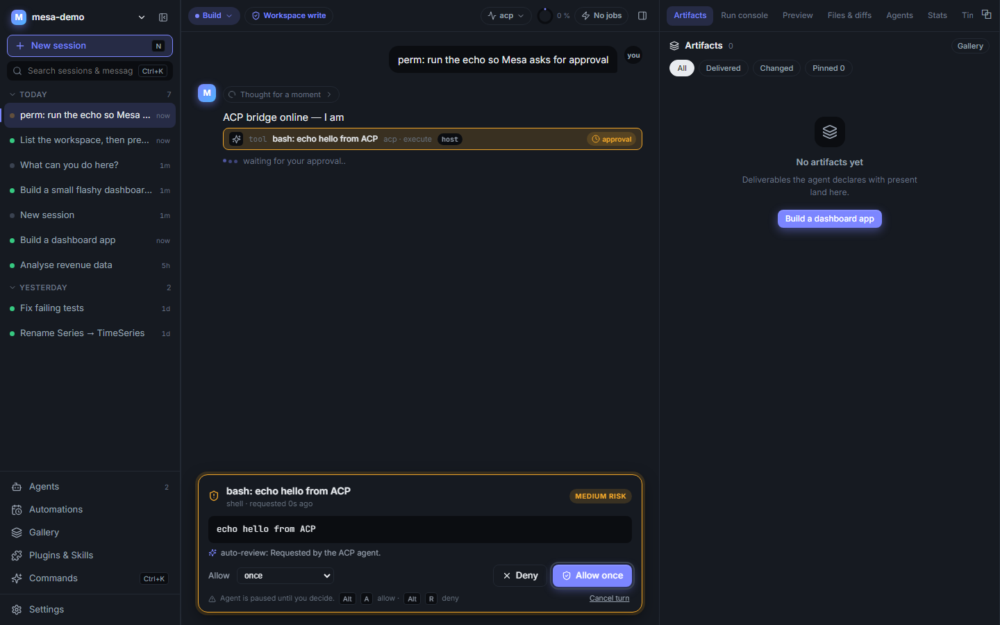

Settings → **Agent → ACP agent** drives an external coding agent that speaks the [Agent Client Protocol](https://agentclientprotocol.com) (JSON-RPC over stdio) — Claude Code, Codex, Gemini CLI and friends via their ACP adapters. The server owns the process (the page can never spawn one): put the command in `mesa.config.json` and restart `serve.mjs`.

```json
{
  "agent": "acp",
  "acp": { "command": "npx", "args": ["-y", "@zed-industries/claude-code-acp"] }
}
```

Mesa performs `initialize` → `session/new` → `session/prompt`, streams `agent_message_chunk` / `agent_thought_chunk` into the thread, turns `tool_call` / `tool_call_update` into tool rows, and shows the agent's `session/request_permission` in the approval takeover — your decision is sent back as the selected option. `Stop` sends `session/cancel`. **Attach & test** in Settings spawns the agent and reports its session id. A reference agent for trying the bridge without any CLI installed ships as `scripts/mock-acp-agent.mjs` (set `"acp": { "command": "node", "args": ["MHarness/app/scripts/mock-acp-agent.mjs"] }`; prompts containing `tool:` exercise a tool call, `perm:` a permission request). Validated against the reference agent; feedback from real adapters is welcome.

---

## Connecting a model

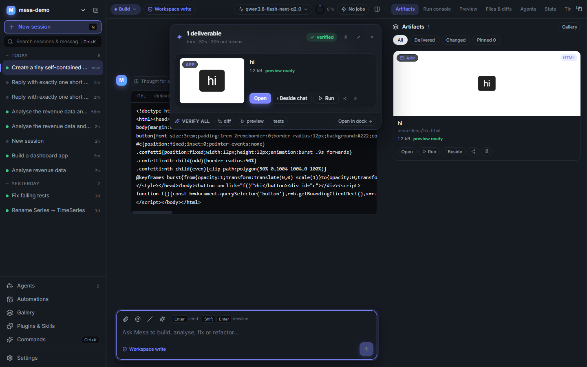

Settings → **Agent → Live model**. Answers stream into the thread; `reasoning_content` is shown as the "Thought for a moment" row.

| Preset | Base URL | Notes |
|---|---|---|
| **Z.AI Coding Plan** | `https://api.z.ai/api/coding/paas/v4` | GLM-4.6 / GLM-4.5-Air with your coding-plan key. Supports tool calling. |
| **Strata (local)** | `http://10.0.0.169:8080/v1` | Your local router; press **Fetch models** to read `/models`. Strata hangs on requests carrying `tools`, so tool calling defaults **off** there and the fence-based prompt is used. |
| OpenAI / Custom | any | Any OpenAI-compatible endpoint. |
| **Mesa mock (offline)** | served by `scripts/serve.mjs` | Scripted model that exercises the full tool loop (bash → approval → present_html) with no key or network. `echo:` prompts stream back verbatim — handy for testing markdown rendering. |

**Tool calling** (`present_html`, `bash`, `read_file`) runs up to 4 rounds per turn; `bash` goes through the approval takeover unless the preset is Full access, then runs for real (if the real shell is enabled) or in the simulated sandbox. A 120 s first-byte watchdog turns a silent hang into a clear error.

**Mesa proxy** — requests to other origins are routed through `/proxy?u=…` in `scripts/serve.mjs`, which forwards only `content-type`/`authorization` to an allow-list (`api.z.ai`, `api.openai.com`, `10.0.0.169`; extend with `PROXY_ALLOW=host1,host2`). This avoids browser CORS on endpoints that don't send CORS headers. Keys stay in your browser's `localStorage`.

**Security** — generated pages render in `<iframe sandbox="allow-scripts">` without `allow-same-origin`; inline HTML in prose is rendered as text, never executed (verified with `` and `window.parent` injection tests).

### Desktop app (experimental)

`MHarness/desktop` is a tiny Electron shell: it starts the Mesa server itself (real shell, notebook execution and ACP included) and opens the built app in its own window — no browser tab, links go to your system browser. `pnpm install && pnpm start` in that folder; `pnpm smoke` verifies the window loads. It is untested on other machines so far, so please report back on [#6](https://github.com/woolcoxm/mesa/issues/6).

### Skills

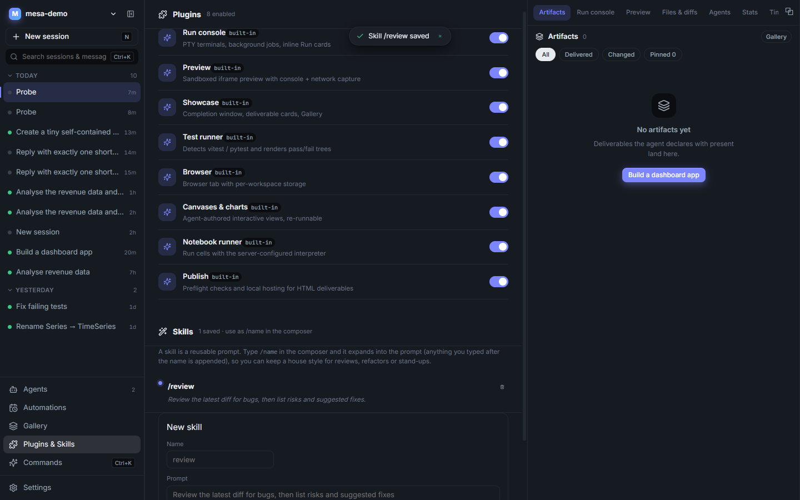

**Skills** (Plugins & Skills page) are reusable prompts: save one, then type /name extra instructions in the composer and it expands into the prompt with your additions. Built-in plugin toggles persist too. The composer's /export downloads the session ledger and /share opens Publish for the latest HTML deliverable.

### Automations

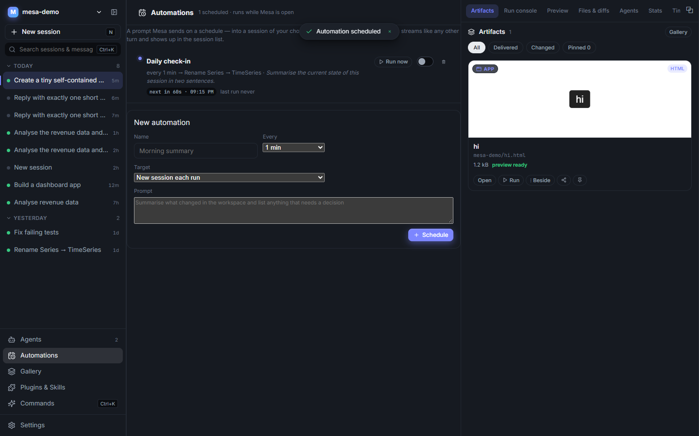

**Automations** (left rail) schedule a prompt to run every N minutes or hours while Mesa is open — into a session you pick, or a fresh session each time. Each run streams like any other turn (approvals included), the row shows a live countdown to the next run and when it last ran, and **Run now** fires it immediately.

---

## Keyboard

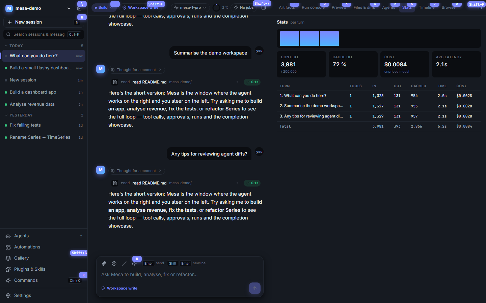 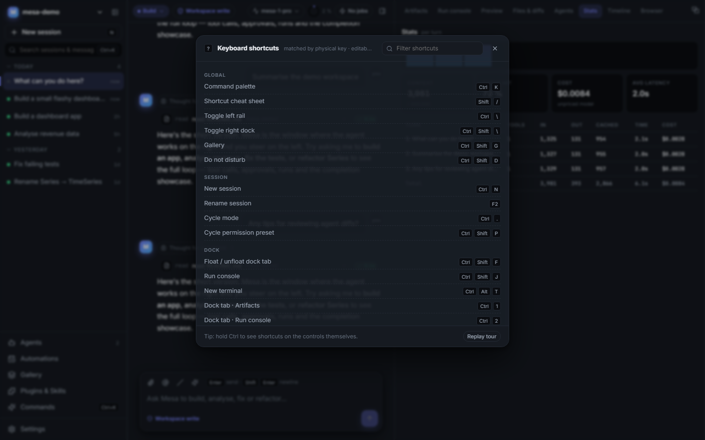

Hold **Ctrl/⌘** to reveal every available shortcut as a badge on its control, or press **`?`** for a searchable cheat sheet. Every shortcut is **editable** in Settings → Keyboard (click a chord, press the new one; conflicts are rejected; reset one or all). Chords are matched by physical key, so they work on any layout; on macOS primary chords use ⌘ and secondary ones ⌃, so browser shortcuts are never stolen.

| | | | |
|---|---|---|---|
| `Ctrl+K` | Command palette | `Ctrl+N` | New session |
| `Enter` | Send | `Shift+Enter` | Inject at next tool call |
| `Alt+Enter` | Queue message | `Alt+A` / `Alt+R` | Allow / deny approval |
| `Esc` | Close palette · gallery · showcase · deny approval | `Ctrl+.` | Cycle mode (Plan · Build · Auto) |
| `Ctrl+Shift+P` | Cycle permission preset | `Ctrl+1…8` | Right-dock tabs |
| `Ctrl+Shift+F` | Float / unfloat dock | `Ctrl+Shift+G` | Gallery |
| `Ctrl+Shift+J` | Run console | `Ctrl+Alt+T` | New terminal |
| `Ctrl+\` / `Ctrl+Shift+\` | Toggle rail / dock | `Ctrl+Shift+D` | Do not disturb |
| `F2` | Rename session | | |

---

## Architecture

```
MHarness/app/src
  state/       types · event-sourced store (sessions, turns, runs, approvals, artifacts) · agent runner
  agent/       provider.ts (OpenAI-compatible SSE + tool calling, proxy URL builder, prompts)
               scenarios.ts (scripted demo agent: tool calls, runs, approvals, deliverables)
  components/  Rail · Header · Thread · Composer · Dock tabs · RunConsole · Showcase · Palette · Gallery · Pages · Confetti
  styles/      tokens.css (--mesa-*) · app.css
scripts/serve.mjs   static server + model proxy + offline mock model (SSE, tool calls)
```

- **Ledger as the single source of truth.** Every tool call, run, approval, artifact and checkpoint is appended to a session's timeline; the thread, dock tabs, stats and timeline are projections. Reload marks interrupted turns as cancelled.
- **Showcase system.** Deliverables declared by the agent (or extracted from ```` ```html ```` fences) become content-versioned artifacts with live thumbnails; the window stacks, minimises to a tray, and respects Do-not-disturb.
- **Provider adapter.** One `streamChat` handles SSE deltas, reasoning deltas and OpenAI-style `tool_calls` accumulation; the mock endpoint in `serve.mjs` speaks the same protocol.

The original design brief — vision, IA, showcase/run system specs, 12 interaction flows, design tokens, architecture, plugin/slot API, roadmap and competitive positioning — lives in [`MHarness-design/`](MHarness-design/README.md). The developer guide with the implemented-feature table is in [`MHarness/app/README.md`](MHarness/app/README.md).

---

## Testing

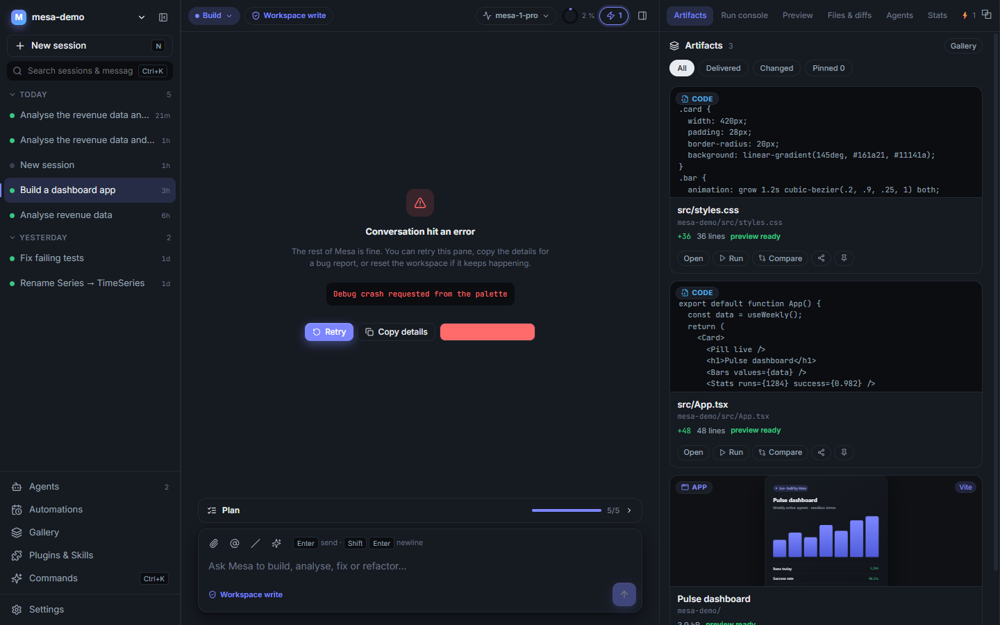

**Robustness** — every pane and dialog sits behind an error boundary: a rendering bug shows a recovery card (Retry · Copy details · Reset workspace) while the rest of the shell keeps working, and uncaught errors or rejected promises surface as toasts instead of failing silently. The server survives a throwing request handler, and live turns have a first-byte watchdog and a cancellation path.

**CI** (`.github/workflows/ci.yml`) runs on every push to `main` and on pull requests, on **Ubuntu, macOS and Windows**: install → typecheck → build → `scripts/smoke.mjs`, which boots the server with the real shell enabled and verifies the app, the shell status, a quoted command, exit-code propagation, the workspace boundary and the offline mock.

**Screenshots** — `pnpm shots` (after `npx playwright install chromium` once) replays a deterministic demo in headless Chromium and rewrites every image in `docs/screenshots/`, so the README never drifts from the UI.

**UI verification** — a scripted Playwright pass (~140 checks across every screen and control), capturing `pageerror` as the crash signal and reviewing screenshots of each state. Coverage includes: boot and persistence (including corrupted and old-schema storage), rail actions (search, collapse, rename, delete, delete-all), header menus and cycling, composer (`@`, `/`, attach, queue/inject/stop/flush), approval decisions (Esc, Alt+R with reason, always-allow, cancel-from-takeover), showcase behaviours (pin-all, minimise/restore, DND, deleting the showcased session), run console (typing, `clear`, Ctrl+C, kill/restart/notify, shortcuts from terminal focus), preview (device sizes, console/network, screenshot-to-chat, ad-hoc run), files/diffs, agents, stats, timeline, browser tab, gallery (filter, search, compare, re-run), palette, exports, provider edge cases (unreachable/malformed URLs, stale responses), markdown/XSS injection, the real shell (approval → real `ls` output → exit code in the console), publish preflight (clean page publishes; embedded secrets refused with 422), extreme viewports, drag-resize of both sidebars, and the editable shortcut table (rebind, conflict rejection, reset).

---

## Roadmap

Tracked as GitHub issues. Shipped so far: real shell for live agents, guided tour and accent colours, canvas beside chat, **keyboard shortcut editor** (#2), **publish with preflight** (#4, local hosting), **notebook renderer** (#3, read-only), cross-browser persistence via the workspace state file (part of #1), cross-platform CI with a real-shell smoke test, and the **ACP bridge** for external agents (#5, validated against the reference agent). Also shipped as experimental: the **desktop shell** (#6, Electron; native PTYs still to come). Still planned: SQLite + FTS5 for large histories (#1), public hosting for published links. The original 12-week plan is in [`MHarness-design/09-roadmap.md`](MHarness-design/09-roadmap.md).

## Changelog & license

See [CHANGELOG.md](CHANGELOG.md) for releases. [MIT](LICENSE) © 2026 Mark W.
