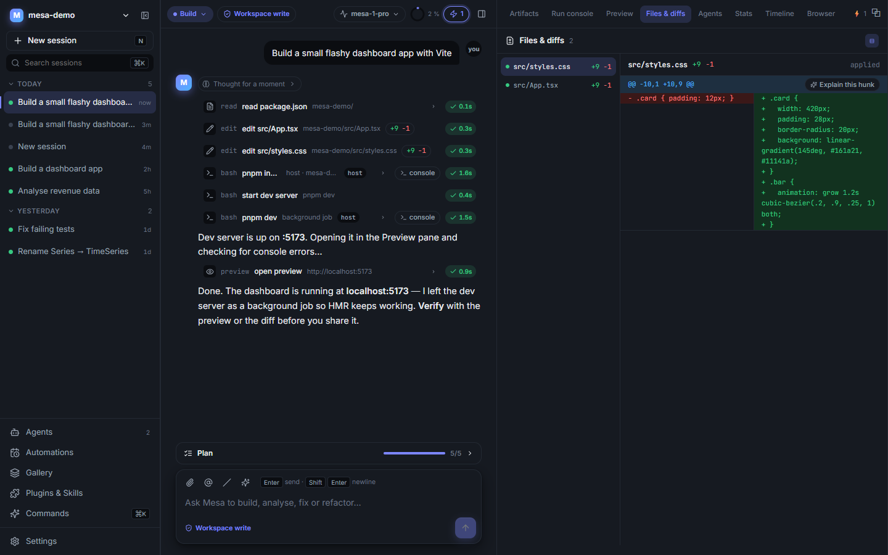
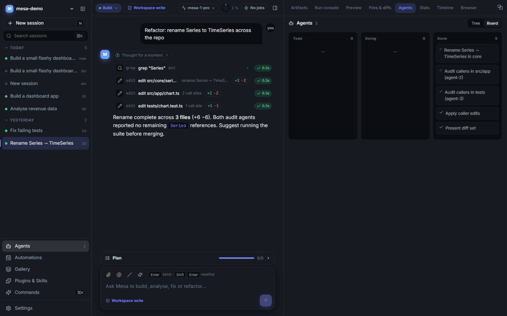
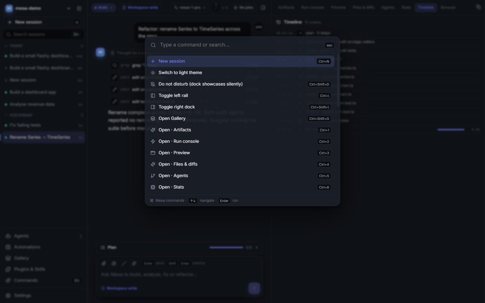
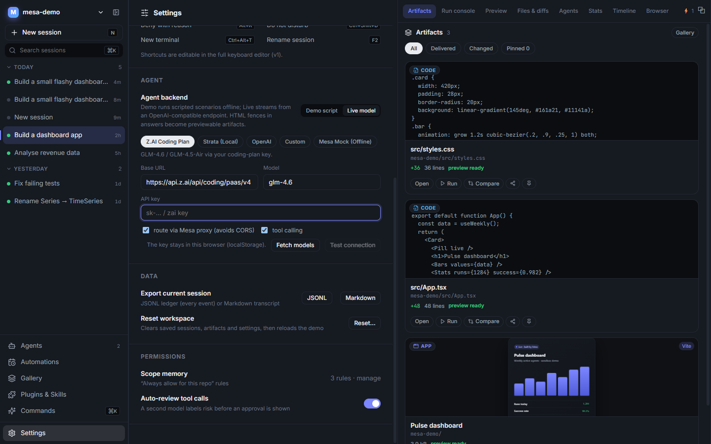

# Mesa

**A visual harness for LLM agents — the agent reads, writes, runs and *shows*; you steer, approve, inspect and launch.**

Mesa is a single window where a person and an LLM agent co-work. The conversation streams in the center; everything the agent produces lands on the right as an **artifact** you can open, run, compare and pin. When a turn finishes with deliverables, a **Completion Showcase** slides in with a hero card per artifact and one-click **Verify** (diff · preview · tests) — because the agent may be wrong, verification is never more than a click away.


| | |
|---|---|
| Stack | React 19 · TypeScript · Vite · xterm.js — zero UI framework, design tokens in CSS variables |
| Models | Any OpenAI-compatible endpoint: **Z.AI Coding Plan**, **Strata**, OpenAI, custom, or the built-in **offline mock** |
| Modes | Scripted demo agent (no network) · live streaming with tool calling |
| Persistence | Event-sourced session ledger, saved locally; survives reloads |
| License | MIT |

---

## Why

Today's agent harnesses make you *read* what happened. Mesa makes you **see** it: a generated dashboard is a live thumbnail in the showcase, a refactor is a diff you can flip to split view, a test run is a pass/fail artifact, and a dev server is a terminal you can type into. Every claim the agent makes can be turned into a rendered artifact or a test result in one click.

Design principles: **show, don't tell** · **verify is one click away** · **every flourish has a job and an off-switch** · **one ledger** (every pane is a projection of the same events) · **platform, not monolith**.

---

## Feature tour

| | |
|---|---|
|  |  |
| **Three-pane shell** — session tree with state dots, streaming thread with tool rows, right dock with 8 tabs, command palette (`Ctrl+K`), light/dark/system themes. | **Approval takeover** — the composer becomes a decision: the exact command with flagged tokens, auto-review rationale, *allow once / always for this repo / deny with reason*. `Esc` denies, `Alt+A` allows. |
|  |  |
| **Live preview** — sandboxed iframe (no `allow-same-origin`), device sizes, console/network capture, screenshot-to-chat, element-to-agent. HTML code blocks in chat have a **Run** button. | **Run console** — real xterm PTY tabs per session, background jobs with kill/restart/notify, a simulated shell you can type into (`ls`, `git status`, `pnpm test`…). |
|  |  |
| **Files & diffs** — unified or split view, animated hunk reveals, "Explain this hunk" sends the hunk to the agent, hover peeks on every diff chip. | **Agents** — subagent tree with status and cost, or a kanban board of the plan. |
|  |  |
| **Gallery** — every deliverable across sessions: filters, search, detail view, side-by-side compare, re-run with fresh inputs, share links. | **Command palette** — fuzzy, keyboard-first; every tab, mode, demo and session is one keystroke away. |
|  |  |
| **Settings** — provider presets (Z.AI, Strata, OpenAI, custom, mock), "Fetch models", "Test connection", export JSONL/Markdown, reset. | **Light theme** — the same tokens; dark and light both meet WCAG AA contrast. |
|  |  |
| **Responsive** — the rail collapses to icons under 960 px and the dock is capped, so the thread stays usable on a laptop. | **Timeline** — every event with timing bars; click an event to flash its tool row in the thread; checkpoints are restorable. |

---

## Quick start

```powershell
git clone https://github.com/woolcoxm/mesa.git
cd mesa/MHarness/app
pnpm install          # node-linker: hoisted is configured in pnpm-workspace.yaml
pnpm build            # vite build → dist/
pnpm preview          # zero-dependency static server → http://127.0.0.1:5173
```

Open **http://127.0.0.1:5173**. It boots with five scripted demo sessions — click **Build a small flashy dashboard app** in the empty state to see the full loop: plan → edits with diffs → an install approval → dev-server job → preview → three deliverables and the showcase.

> `pnpm dev` (Vite dev server + HMR) works too, but use `pnpm preview` / `node scripts/serve.mjs` for the full experience: that server also hosts the model proxy and the offline mock model.

### First-run configuration

Mesa looks for `MHarness/app/mesa.config.json` (git-ignored) and applies it on first launch:

```json
{
  "provider": { "preset": "strata", "baseUrl": "http://10.0.0.169:8080/v1", "apiKey": "…", "model": "…", "proxy": true },
  "agent": "live"
}
```

Without it, the app starts in **Demo** mode, which needs no network or keys.

---

## Connecting a model

Settings → **Agent → Live model**. Answers stream into the thread; `reasoning_content` is shown as the "Thought for a moment" row.

| Preset | Base URL | Notes |
|---|---|---|
| **Z.AI Coding Plan** | `https://api.z.ai/api/coding/paas/v4` | GLM-4.6 / GLM-4.5-Air with your coding-plan key. Supports tool calling. |
| **Strata (local)** | `http://10.0.0.169:8080/v1` | Your local router; press **Fetch models** to read `/models`. Strata hangs on requests carrying `tools`, so tool calling defaults **off** there and the fence-based prompt is used. |
| OpenAI / Custom | any | Any OpenAI-compatible endpoint. |
| **Mesa mock (offline)** | served by `scripts/serve.mjs` | Scripted model that exercises the full tool loop (bash → approval → present_html) with no key or network. `echo:` prompts stream back verbatim — handy for testing markdown rendering. |

**Tool calling** (`present_html`, `bash`, `read_file`) runs up to 4 rounds per turn; `bash` goes through the approval takeover unless the preset is Full access. A 120 s first-byte watchdog turns a silent hang into a clear error.

**Mesa proxy** — requests to other origins are routed through `/proxy?u=…` in `scripts/serve.mjs`, which forwards only `content-type`/`authorization` to an allow-list (`api.z.ai`, `api.openai.com`, `10.0.0.169`; extend with `PROXY_ALLOW=host1,host2`). This avoids browser CORS on endpoints that don't send CORS headers. Keys stay in your browser's `localStorage`.

**Security** — generated pages render in `<iframe sandbox="allow-scripts">` without `allow-same-origin`; inline HTML in prose is rendered as text, never executed (verified with `` and `window.parent` injection tests).

---

## Keyboard

| | | | |
|---|---|---|---|
| `Ctrl+K` | Command palette | `Ctrl+N` | New session |
| `Enter` | Send | `Shift+Enter` | Inject at next tool call |
| `Alt+Enter` | Queue message | `Alt+A` / `Alt+R` | Allow / deny approval |
| `Esc` | Close palette · gallery · showcase · deny approval | `Ctrl+.` | Cycle mode (Plan · Build · Auto) |
| `Ctrl+Shift+P` | Cycle permission preset | `Ctrl+1…8` | Right-dock tabs |
| `Ctrl+Shift+F` | Float / unfloat dock | `Ctrl+Shift+G` | Gallery |
| `Ctrl+Shift+J` | Run console | `Ctrl+Alt+T` | New terminal |
| `Ctrl+\` / `Ctrl+Shift+\` | Toggle rail / dock | `Ctrl+Shift+D` | Do not disturb |
| `F2` | Rename session | | |

---

## Architecture

```
MHarness/app/src
  state/       types · event-sourced store (sessions, turns, runs, approvals, artifacts) · agent runner
  agent/       provider.ts (OpenAI-compatible SSE + tool calling, proxy URL builder, prompts)
               scenarios.ts (scripted demo agent: tool calls, runs, approvals, deliverables)
  components/  Rail · Header · Thread · Composer · Dock tabs · RunConsole · Showcase · Palette · Gallery · Pages · Confetti
  styles/      tokens.css (--mesa-*) · app.css
scripts/serve.mjs   static server + model proxy + offline mock model (SSE, tool calls)
```

- **Ledger as the single source of truth.** Every tool call, run, approval, artifact and checkpoint is appended to a session's timeline; the thread, dock tabs, stats and timeline are projections. Reload marks interrupted turns as cancelled.
- **Showcase system.** Deliverables declared by the agent (or extracted from ```` ```html ```` fences) become content-versioned artifacts with live thumbnails; the window stacks, minimises to a tray, and respects Do-not-disturb.
- **Provider adapter.** One `streamChat` handles SSE deltas, reasoning deltas and OpenAI-style `tool_calls` accumulation; the mock endpoint in `serve.mjs` speaks the same protocol.

The original design brief — vision, IA, showcase/run system specs, 12 interaction flows, design tokens, architecture, plugin/slot API, roadmap and competitive positioning — lives in [`MHarness-design/`](MHarness-design/README.md). The developer guide with the implemented-feature table is in [`MHarness/app/README.md`](MHarness/app/README.md).

---

## Testing

The UI was verified with a scripted Playwright pass (~140 checks across every screen and control), capturing `pageerror` as the crash signal and reviewing screenshots of each state. Coverage includes: boot and persistence (including corrupted and old-schema storage), rail actions (search, collapse, rename, delete, delete-all), header menus and cycling, composer (`@`, `/`, attach, queue/inject/stop/flush), approval decisions (Esc, Alt+R with reason, always-allow, cancel-from-takeover), showcase behaviours (pin-all, minimise/restore, DND, deleting the showcased session), run console (typing, `clear`, Ctrl+C, kill/restart/notify, shortcuts from terminal focus), preview (device sizes, console/network, screenshot-to-chat, ad-hoc run), files/diffs, agents, stats, timeline, browser tab, gallery (filter, search, compare, re-run), palette, exports, provider edge cases (unreachable/malformed URLs, stale responses), markdown/XSS injection, extreme viewports, and drag-resize of both sidebars.

---

## Roadmap

Persistence beyond the browser (SQLite), a real shell tool for live agents, notebooks and canvas renderers, publish with preflight checks, ACP bridge for external agents, and a keyboard-shortcut editor. The full 12-week plan is in [`MHarness-design/09-roadmap.md`](MHarness-design/09-roadmap.md).

## License

[MIT](LICENSE) © 2026 Mark W.
